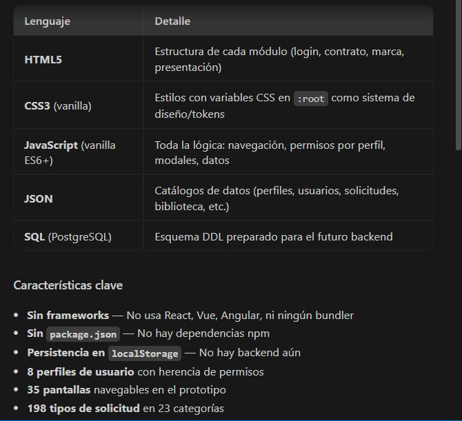

# Portal Somos VEPAGOS — Intranet corporativa

Plataforma interna de gestión para **Somos VEPAGOS**: empleados, perfiles, permisos, menú dinámico, solicitudes, activos, onboarding y más.



---

## Tecnologías

| Capa | Tecnología |
|------|-----------|
| **Frontend** | HTML, CSS (Barlow font), Vanilla JavaScript |
| **Backend** | TypeScript, Express.js |
| **Base de datos** | MySQL 8 |
| **Autenticación** | JWT + bcrypt |
| **Contenedores** | Docker, Docker Compose |

---

## Inicio rápido

### Opción 1 — Docker Compose (recomendado)

```bash
# 1. Clonar el repositorio
git clone https://github.com/tu-usuario/Intranet.git
cd Intranet

# 2. (Opcional) Crear tu .env a partir del ejemplo
cp .env.example .env

# 3. Levantar todo (MySQL + phpMyAdmin + App)
docker compose up -d --build

# 4. Abrir en el navegador
#    Portal:     http://localhost:3000
#    phpMyAdmin: http://localhost:8080
```

El primer inicio puede tardar ~30 segundos mientras MySQL arranca y el seed carga los datos.

### Opción 2 — Desarrollo local (sin Docker)

**Requisitos:** Node.js 20+, MySQL 8 corriendo en localhost:3306 (root sin clave).

```bash
# 1. Instalar dependencias del backend
cd backend
npm install

# 2. Crear base de datos y cargar datos de demo
npm run seed

# 3. Iniciar el servidor en modo desarrollo (hot-reload)
npm run dev

# Portal disponible en http://localhost:3000
```

---

## Usuarios de demo

Todos usan la contraseña: `vepagos2026`

| Perfil | Correo | Cédula |
|--------|--------|--------|
| Administradora | admin@somosvepagos.com | V-10000001 |
| Director | antonio.palermo@somosvepagos.com | V-10000010 |
| Gerente Ejecutivo | mayra.gruber@somosvepagos.com | V-10000070 |
| Gerente Operativo | aymara.gonzalez@somosvepagos.com | V-10000011 |
| Coordinador/Supervisor | victor.torrealba@somosvepagos.com | V-10000071 |
| Capital Humano | rrhh@somosvepagos.com | V-10000077 |
| Equipo interno | gina.sanchez@somosvepagos.com | V-10000014 |
| Pasante INCES | maria.linares@somosvepagos.com | V-10000091 |

---

## Estructura del proyecto

```
Intranet/
├── portal/                  # Frontend (HTML, CSS, JS estático)
│   ├── index.html           # Página principal
│   ├── style.css            # Estilos (Barlow, colores VEPAGOS)
│   ├── app.js               # Lógica del portal (~7200 líneas)
│   ├── api.js               # Bridge fetch ↔ backend API
│   ├── data.js              # Datos auxiliares del frontend
│   └── assets/              # Logos, íconos, PDFs
│
├── backend/                 # Backend TypeScript
│   ├── src/
│   │   ├── index.ts         # Express server (puerto 3000)
│   │   ├── config/
│   │   │   └── database.ts  # Pool MySQL (env vars)
│   │   ├── middleware/
│   │   │   └── auth.ts      # JWT auth + adminOnly guard
│   │   ├── routes/          # 6 routers API
│   │   ├── services/        # auth, menu, permission
│   │   └── types/           # Interfaces TypeScript
│   ├── seed/
│   │   └── seed.ts          # Seed: carga datos/*.json en MySQL
│   ├── sql/
│   │   └── schema.sql       # Esquema DDL MySQL
│   └── package.json
│
├── datos/                   # JSONs fuente para el seed
│
├── Dockerfile               # Imagen de la aplicación
├── docker-compose.yml       # MySQL + phpMyAdmin + App
├── docker-entrypoint.sh     # Entrypoint: espera MySQL → seed → start
├── .env.example             # Variables de entorno de ejemplo
├── .gitignore
└── README.md
```

---

## Variables de entorno

| Variable | Default | Descripción |
|----------|---------|-------------|
| `DB_HOST` | `127.0.0.1` | Host de MySQL |
| `DB_PORT` | `3306` | Puerto de MySQL |
| `DB_USER` | `root` | Usuario de MySQL |
| `DB_PASSWORD` | *(vacío)* | Contraseña de MySQL |
| `DB_NAME` | `intranet_vepagos` | Nombre de la base de datos |
| `PORT` | `3000` | Puerto del servidor Express |
| `JWT_SECRET` | `vepagos_intranet_secret_2026` | Secreto para firmar JWT |
| `PORTAL_PATH` | `(auto)` | Ruta al directorio portal/ |

---

## Comandos Docker

```bash
# Levantar todo
docker compose up -d --build

# Ver logs en tiempo real
docker compose logs -f app

# Detener todo
docker compose down

# Detener y borrar datos (MySQL)
docker compose down -v

# Reconstruir solo la app
docker compose up -d --build app

# Ejecutar seed manualmente
docker compose exec app npx tsx /app/backend/seed/seed.ts
```

---

## API Endpoints

| Método | Ruta | Auth | Descripción |
|--------|------|------|-------------|
| `POST` | `/api/auth/login` | ❌ | Login (email + password + cédula) |
| `GET` | `/api/auth/me` | ✅ | Datos del usuario actual |
| `GET` | `/api/menu` | ✅ | Menú dinámico según perfil |
| `GET` | `/api/users` | ✅ Admin | Listar usuarios |
| `GET` | `/api/perfiles` | ✅ | Listar perfiles/roles |
| `GET` | `/api/pantallas` | ✅ | Listar pantallas de menú |
| `PUT` | `/api/pantallas/perfil/:key` | ✅ Admin | Asignar menús a un perfil |
| `GET` | `/api/permisos/catalogo` | ✅ | Catálogo de permisos |
| `POST` | `/api/permisos/grant` | ✅ Admin | Conceder permiso individual |
| `GET` | `/api/health` | ❌ | Health check |

---

## Licencia

Proyecto privado — © Somos VEPAGOS. Todos los derechos reservados.
